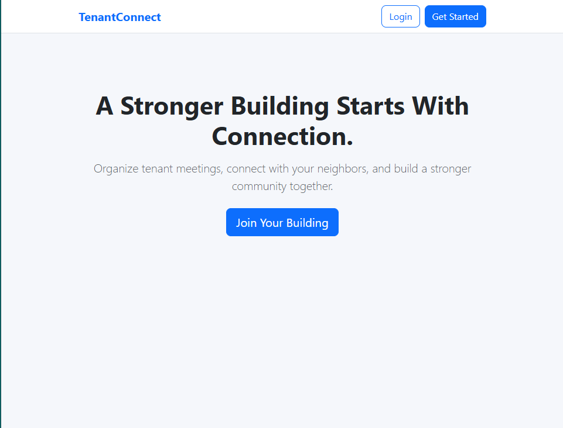

# TenantConnect — Tenant Community Management Platform

TenantConnect is a full-stack web application designed to help residents within the same building stay connected, organize meetings, and improve community communication.

Built with the **MVC architecture**, the application demonstrates user authentication, role-based data access, and MongoDB CRUD operations.

## Project Preview



*TenantConnect application preview.*

## Features

- **User Authentication:** Secure registration, login, and logout.
- **Building-Based Communities:** Users are associated with their residential building.
- **Meeting Management:** Create, view, edit, and delete tenant meetings.
- **Access Control:** Users only see meetings associated with their building.
- **Meeting Ownership:** Only meeting creators can edit or delete their meetings.
- **Persistent Sessions:** Login sessions are stored using MongoDB.
- **Responsive Interface:** Clean, mobile-friendly design using Bootstrap.

## Tech Stack

**Frontend:** HTML, CSS, EJS, Bootstrap 5

**Backend:** Node.js, Express.js

**Database:** MongoDB Atlas, Mongoose

**Authentication:** Express Session, bcryptjs, connect-mongo

**Architecture:** MVC (Model-View-Controller)

## Getting Started

Clone the repository and install dependencies:

```bash
git clone https://github.com/AnwarAlshohatee/tenantconnect.git
cd tenantconnect
npm install
```

Create a `.env` file:

```env
PORT=3001
MONGODB_URI=your_mongodb_connection_string
SESSION_SECRET=your_secure_session_secret
```

Start the development server:

```bash
npm run dev
```

Open `http://localhost:3001` in your browser.

## Future Improvements

- Tenant announcements and community discussions
- Maintenance and repair request tracking
- Meeting reminders and notifications
- Building administrator dashboards
- Community voting and polls

## Author

**Anwar Alshohatee** — Software Engineer

[GitHub](https://github.com/AnwarAlshohatee)